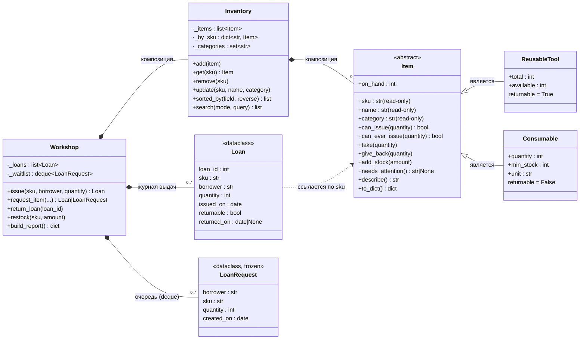
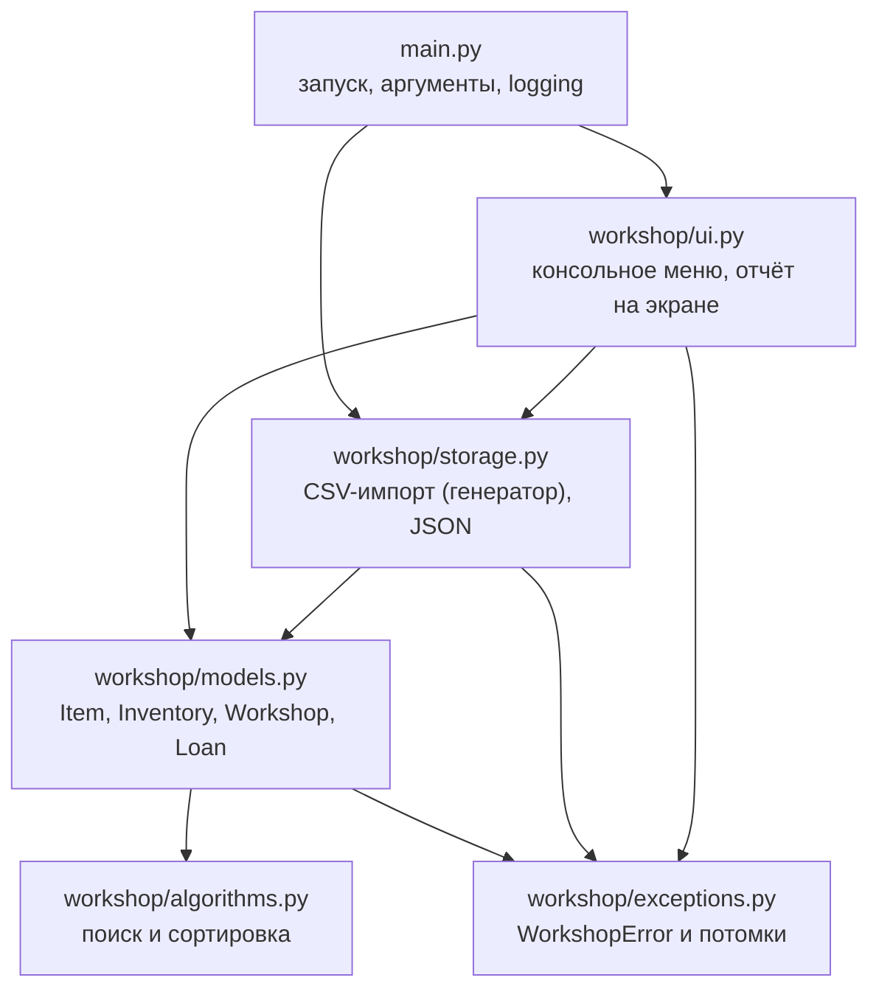
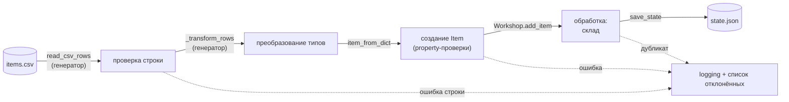

# Схема классов и компонентов

Диаграммы в формате Mermaid (отображаются на GitHub и в VS Code с расширением Markdown Preview Mermaid).

## Классы

**Композиция.** `Workshop` создаёт и владеет `Inventory`, списком `Loan` и очередью `LoanRequest`;
`Inventory` владеет объектами `Item`. Эти объекты не живут отдельно от склада.

**Наследование** есть только там, где верно «является»: инструмент *является* предметом склада,
расходник *является* предметом склада. `Loan` и `LoanRequest` — просто данные, поэтому это `dataclass`
без наследования.

## Модули

## Поток данных при импорте

